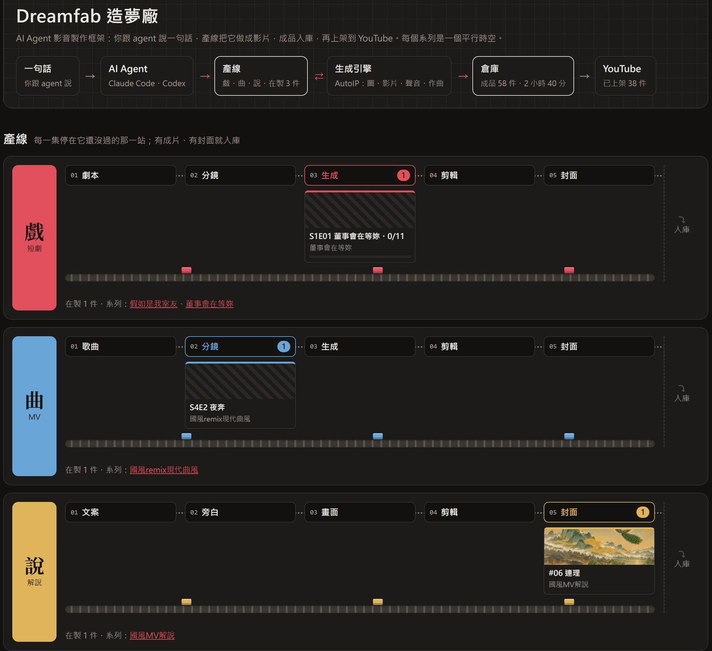
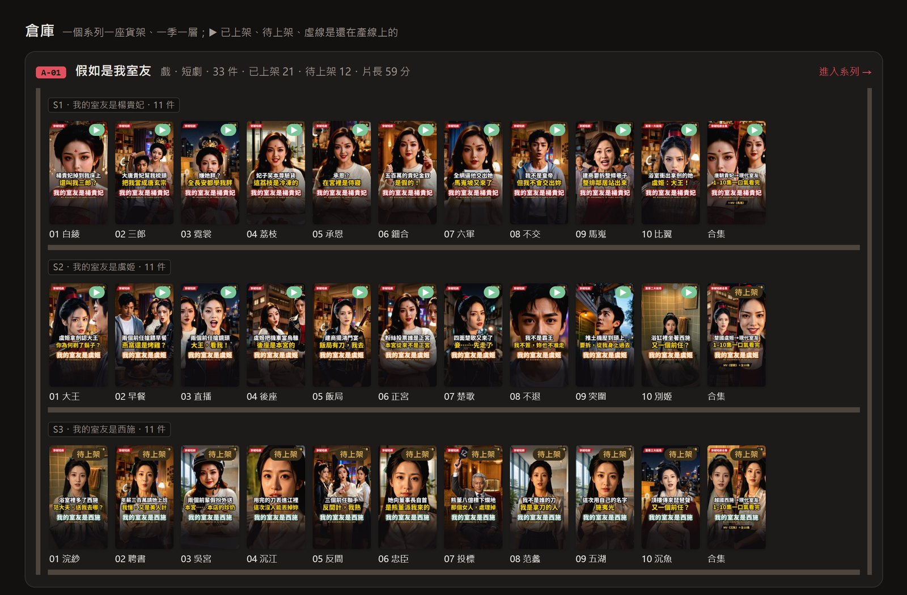
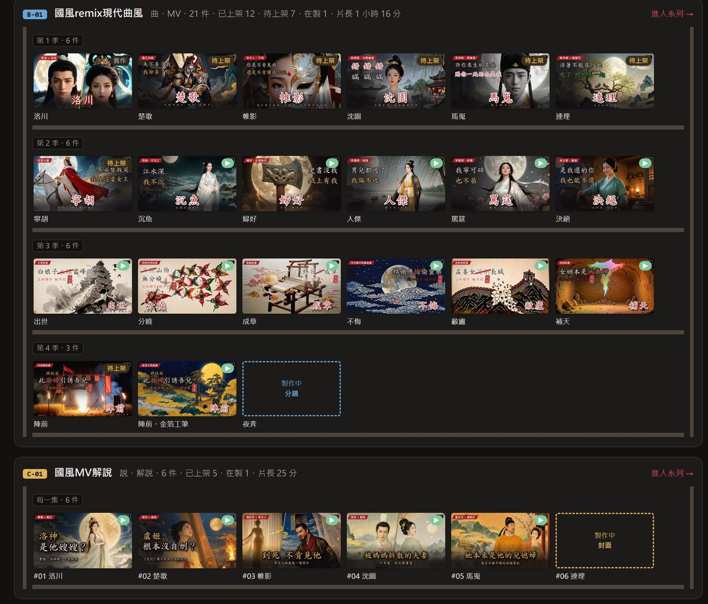

# Dreamfab 造夢廠

**An AI agent framework for making video: say one sentence and you are the director and producer, while an AI agent makes the film you dream of.**

[中文](README.md) | English

Dreamfab is a framework that lets AI agents (Claude Code, Codex) make videos on their own. Tell the agent one sentence and it follows a production line's skill: writes the script, submits generation jobs, checks the review sheets, edits, subtitles, mixes and publishes. Every batch of jobs that costs credits is priced first and goes out only when you say so.

It has three layers:

- **Production lines**: one line per kind of video (short drama, music video, explainer...), each with its own workflow, formats and skill. A new kind of video is a new line.
- **Generation engines**: pictures, video, voices and lip-sync come from outside engines. Today that is the public [AutoIP](https://autoip.ai) API: text-to-image (v4 = MOSS-Image), image-to-video, multi-reference video, lip-sync, voice cloning and AI songs. More image and video engines will follow, and each line will pick what it needs.
- **The shared core** `dreamfab/`: submitting jobs, credits, half-price off-peak runs, local GPU super resolution and frame generation, local editing and rendering (ffmpeg + libass), the library page, YouTube publishing. Every line and every engine uses the same core.

## Lines: 戲・曲・說・影・聞

| Line | Tell the agent | Status | Docs |
|---|---|---|---|
| **戲** short drama `drama/` | Use dreamfab-drama to turn script.md into a short drama | Ready | [Drama overview](docs/en/drama/OVERVIEW.md) |
| **曲** music video `mv/` | Use dreamfab-mv to turn song.mp3 into a music video | Ready | [MV overview](docs/en/mv/OVERVIEW.md) |
| **說** explainer `explain/` | Use dreamfab-explain to explain the history behind my MV in 5 minutes | Ready (static B-roll; moving B-roll planned) | [Explainer overview](docs/en/explain/OVERVIEW.md) |
| **影**, **聞** film, news | — | Later | — |

**Before every batch of jobs the agent shows you a review sheet and the credit estimate**; nothing goes out until you say so.

## Showcase

**Short drama 《我的室友是楊貴妃》** (My Roommate Is Yang Guifei), made with the drama line: Yang Guifei falls from Mawei into the flat of a talent agent three million in debt. Season one, 10 episodes of about 50 seconds, is all out. <!-- public-ok -->

- ▶ Episode 1: https://youtu.be/kA4J9kLOVVo <!-- public-ok -->
- ▶ The whole season: https://www.youtube.com/playlist?list=PLFDknh7mplug
- 🎵 The same character's MV 《馬嵬》: https://youtu.be/C6aGMU8mKdw (made with the MV line; the drama and the MV link to each other in their descriptions) <!-- public-ok -->

**Music videos**: one MV line, four genres and looks. Click a thumbnail to watch on YouTube.

| **Dark metal epic** | **Wong Kar-wai-style Cantopop ballad** | **Chinese-style duet** | **Cyberpunk female rap** |
|:---:|:---:|:---:|:---:|
| [](https://youtu.be/ErQCd04OGA8) | [](https://youtu.be/fMTLkI7qDq8) | [](https://youtu.be/OlIQYvfwZhA) | [](https://youtu.be/fZ9SlclC9ng) |

A whole season of MVs: the [《國風淒美對唱》 playlist](https://www.youtube.com/playlist?list=PLfoBI7oPycHg), 6 episodes with one look and packaging, a different genre each.

## One-line install (Claude Code / Codex)

**macOS / Linux / Git Bash:**

```bash
curl -fsSL https://raw.githubusercontent.com/autoip/dreamfab/main/install.sh | bash
```

**Windows PowerShell:**

```powershell
irm https://raw.githubusercontent.com/autoip/dreamfab/main/install.ps1 | iex
```

The tools go into `~/.dreamfab` (with a Python virtual environment) and the skills into both Claude Code and Codex. All three lines are installed by default (`DREAMFAB_LINES=drama,mv,explain`); for short dramas only, set `DREAMFAB_LINES=drama` and skip the MV line's large packages. Or install as a plugin:

```bash
claude plugin marketplace add autoip/dreamfab && claude plugin install dreamfab@dreamfab
codex plugin marketplace add autoip/dreamfab && codex plugin add dreamfab@dreamfab
```

ffmpeg (with libass), fonts and `AUTOIP_API_KEY` are up to you: see [SETUP.md](docs/en/SETUP.md).

**Updating**: run the same line again. An older version's per-series `library.db` files and its publishing log `youtube_log.db` come into the new shared database by themselves, the old files kept as `.merged`; to bring them all in at once, with files kept elsewhere, or to go back, see [SETUP.md, Updating from an older version](docs/en/SETUP.md#7-updating-from-an-older-version).

## A virtual troupe and parallel universes

- **Parallel universes**: each series is a world of its own in `projects/<series>/`, one folder and one `project.py` per episode or song.
- **A virtual troupe**: `projects/<series>/cast/` and `voices/` are that world's actors and voices, cast again across episodes and seasons with the same face and voice.
- **The library**: one local web page for every episode, shot, character, credit and upload of every world; see the next section.

## The local library page

After a while your material is spread over dozens of folders: every episode's `project.py`, shots, voices, job records, cuts, covers and upload records. The library turns every series under `projects/` into one local web page where you browse, play and search them, without digging through folders.

```bash
python dreamfab/library.py serve projects     # opens http://127.0.0.1:8765
python dreamfab/library.py list projects      # just lists the series it finds and their line
```

**Home is the factory floor.** The top row is the flow: one sentence → AI agent → production lines ⇄ generation engines → warehouse → YouTube, each with its numbers (in the making, finished, uploaded).

**Production lines**: one conveyor each for drama (戲), MV (曲) and explainer (說), with that line's stations (drama: script → storyboard → generation → cut → cover; explainer: script → narration → pictures → cut → cover). Every episode still being made sits at the first station it has not passed and links to its page; a line with work on it runs, its rollers turning and parcels riding into the warehouse. Film (影) and news (聞) are lines still to come.



**Warehouse**: a rack per series and a shelf per season, each episode standing on it by its cover, marked ▶ uploaded or waiting (待上架); one still on a line keeps a dashed slot that names its station. A rack's name opens that series' library. Folders that are not a series yet are under "loose items" (散件區).





- **Drama series**: every episode's cover, length, shot count, credits and YouTube status; an episode page has the cut, every shot's lines with the speech-recognition match and clip thumbnails; cast, sets and job credits are all there. See [Drama overview, Library page](docs/en/drama/OVERVIEW.md#library-page).
- **MV series**: every episode's cut, stills, clips (old takes and candidates too), characters, lyrics, edit list, credits and uploads. See [MV overview, Library page](docs/en/mv/OVERVIEW.md#library-page).
- **Explainer series**: one card per episode showing how far it is along script → narration → pictures → cut → covers → upload. An episode page has the cut with its chapters (click one to jump there), covers A/B/C, every picture with its note, the narration, the full script and the YouTube title and description; the series page also lists the shared narrator voice and each MV's instrumental.
- **Other folders**: open `/files/<path>` and a folder becomes a page, with players for audio, video and images and Markdown shown inline. Add `?raw` to an explainer page for the plain file listing.
- Video and audio can be scrubbed, so you can review a cut or a narration right in the browser.
- It listens on `127.0.0.1` only. Drama and MV indexes live in the shared database `~/.config/dreamfab/dreamfab.db` (outside the repo) and re-index while the page is open; explainer pages read the folders every time, so new files show up at once.
- Paste addresses straight into the conversation: when the agent finishes an episode it answers with a library link for you to review, and you can paste an episode's or a shot's link back to say what to change.

## The shared core `dreamfab/`

| File | What it does |
|---|---|
| `aip_runner.py` | Submits AutoIP jobs, polls, downloads; resumable, one at a time, `--off-peak` submits only in the half-price window |
| `util.py` | Project loading, ffmpeg, the NVIDIA encoder (used whenever available), credit estimates |
| `enhance.py` | The engine for local NVIDIA 2x super resolution + 60 fps frame generation (each line's `enhance.py` calls it): [GPU_ENHANCE.md](docs/en/GPU_ENHANCE.md) |
| `library.py` | The local library page for every series (see "The local library page") |
| `youtube_api.py`, `youtube_playlists.py` | YouTube login (with a channel lock), playlist tidying |
| `db.py` | the shared database: every line's and every series' library index and the publishing log in one SQLite file, `~/.config/dreamfab/dreamfab.db` (`show` lists it; an older version's per-series `library.db` files and `youtube_log.db` come in by themselves, `merge` brings them all in at once) |
| `youtube_log.py` | the publishing log (table `youtube_log` of the shared database): upload, update, publish, comment, pin, end screen, card, links between episodes, each with its time (the uploaders record their own steps; what is done by hand in Studio is added with `add`); the library's home page and explainer pages read it |
| `workflow.py` | Workflow switches: off-peak only, tasks at once, the explainer's Short, GPU enhance, upload privacy, the publishing log, each on or off; one file for you, another per series if it differs ([WORKFLOW.md](docs/en/WORKFLOW.md)) |
| `credits.py` | Audit: what each job folder actually cost |
| `check_public.py` | The de-identification check before you send: keys, personal data, the words of your own work |
| `gpu_check.py`, `make_static_font.py` | What this machine's GPU can take over; static font weights for libass |

## Docs

| Doc | Contents |
|---|---|
| [SETUP.md](docs/en/SETUP.md) | Install, GPU, API key, off-peak pricing, YouTube login, rights to your material, updating from an older version |
| [Drama overview](docs/en/drama/OVERVIEW.md) | The drama line: workflow, format, editing, publishing, lessons |
| [MV overview](docs/en/mv/OVERVIEW.md) | The MV line: workflow, format, emotional beat editing, publishing, lessons |
| [GPU_ENHANCE.md](docs/en/GPU_ENHANCE.md) | Local super resolution + frame generation: tools, measured speed and results |
| [WORKFLOW.md](docs/en/WORKFLOW.md) | Workflow switches: which steps happen on their own is your call |
| [CONTRIBUTING.en.md](CONTRIBUTING.en.md) | Contributing: what belongs in the repo, de-identification, the check before you send |

## Where it is going

- **More generation engines**: other cloud APIs and local models for images, video and voices, so one line can switch engines and compare quality and price.
- **More production lines**: film (影), news (聞) and more formats; the shared core stays, and a new line only writes its own workflow and skill.
- **Fuller agent automation**: from one sentence to publishing, with the agent reviewing and fixing its own cuts; people step in only before spending credits and before going public.

## Licence

[MIT](LICENSE). What you make with Dreamfab is yours; use only material you have the rights to (see [SETUP.md, Rights to your material](docs/en/SETUP.md#6-rights-to-your-material)).
