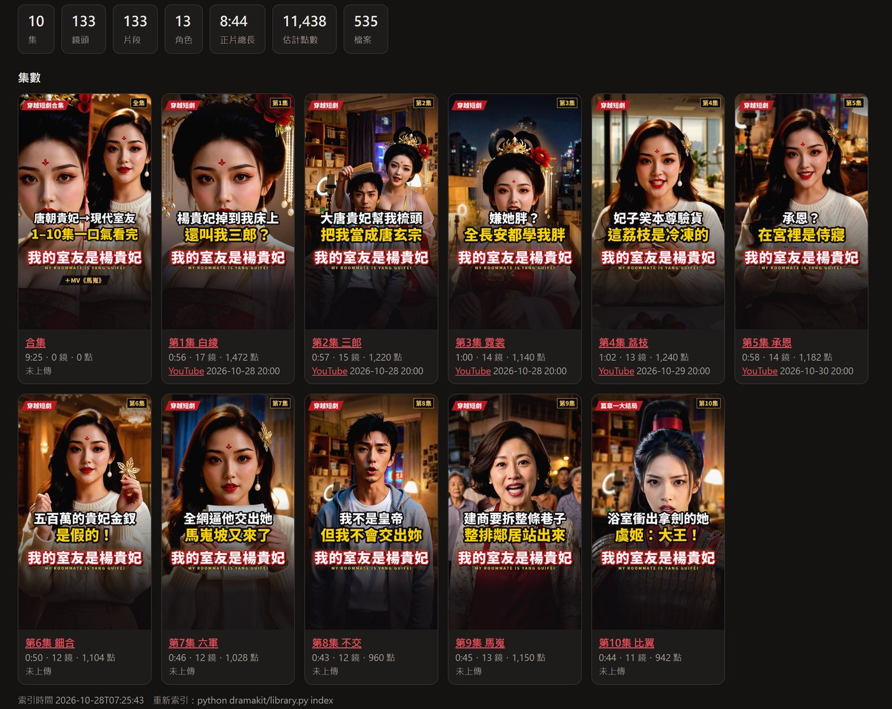
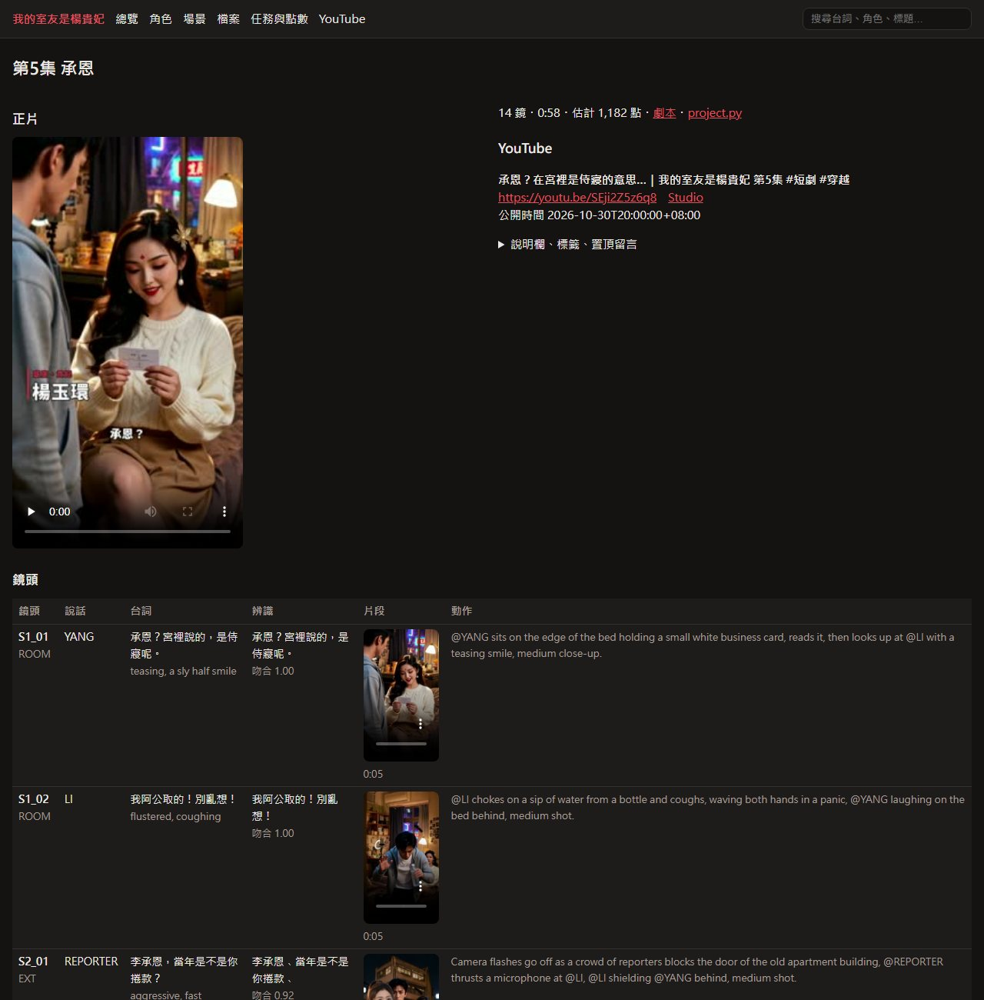

# Dreamfab · 戲：AI 短劇製作管線

中文 | [English](../../en/drama/OVERVIEW.md)

把劇本做成直式短劇的半自動流程。一集 1–2 分鐘：

- 固定的角色造型與聲音：每個角色用自己的聲音樣本講台詞，嘴型一起生成
- 依台詞剪輯：正反打、反應鏡頭、L/J cut、爽點推近加音效、卡點定格「未完待續」
- 台詞字幕、人物字卡、片名卡；配樂自動壓在對白下面
- 直式封面、標題、說明欄；整部劇的企劃框架

影像與語音生成使用 [AutoIP](https://autoip.ai) 公開 API：多參考影片（角色、場景、道具參考圖＋台詞＋聲音樣本）、對嘴、圖生影片、關鍵幀影片、文生圖、圖生圖。剪輯、字幕、混音與合成全部在本機用 ffmpeg + libass 完成。

架構沿用 MV 線（`mv/`）：一集一個 `project.py`、每一批任務送出前先看審核圖、可續跑的 runner。

## 示範作品

**《我的室友是楊貴妃》**：用這套流程做的穿越短劇。楊貴妃從馬嵬坡掉進負債三百萬的經紀人家裡，篇章一共 10 集，每集約 50 秒，在 [AutoIP 官方音樂頻道](https://www.youtube.com/channel/UCyVWk24QFKZFV0wtayOsnlw) 每天晚上 8 點（台灣時間）更新一集。 <!-- public-ok -->

- ▶ 第 1 集：https://youtu.be/kA4J9kLOVVo <!-- public-ok -->
- ▶ 全集播放清單：https://www.youtube.com/playlist?list=PLFDknh7mplug
- 🎵 同一個角色的 MV《馬嵬》：https://youtu.be/C6aGMU8mKdw（用 MV 線（`mv/`） 做的；短劇和 MV 的說明欄互相連結） <!-- public-ok -->

篇章一的規模：133 顆鏡頭、13 個角色、7 個場景，正片合計 8 分 44 秒，估計約 11,400 點（含定裝、聲音與重拍）。下面〈資源庫網頁〉的截圖就是這部劇的資料。

## 一句話做出一集短劇

裝好之後（安裝方式見下方），在 Claude Code 或 Codex 裡說：

```text
用 dreamfab-drama 把 劇本.md 做成短劇
```

agent 會照流程一步一步做。**每一批任務送出前，都會先給你看審核圖、報點數**，你點頭才會送出。

要做一整部劇：

```text
用 dreamfab-drama 規劃一部 30 集的短劇：<題材>
```

agent 會先問你題材、爽點引擎、篇章和想固定的錨點，寫好整部劇的企劃（`plan.md`）、人物設定（`characters.md`）和風格聖經（`style.md`）給你確認，再一集一集做。框架有公式，故事和風格全部由你決定。方法見 [SERIES_PLANNING.md](SERIES_PLANNING.md)。

## 一行安裝（Claude Code / Codex）

**macOS / Linux / Git Bash：**

```bash
curl -fsSL https://raw.githubusercontent.com/autoip/dreamfab/main/install.sh | bash
```

**Windows PowerShell：**

```powershell
irm https://raw.githubusercontent.com/autoip/dreamfab/main/install.ps1 | iex
```

安裝程式會把工具裝到 `~/.dreamfab`（含 Python 虛擬環境），skill 會同時裝進 Claude Code 和 Codex。

也可以改用 plugin 安裝：

```bash
claude plugin marketplace add autoip/dreamfab && claude plugin install dreamfab@dreamfab
codex plugin marketplace add autoip/dreamfab && codex plugin add dreamfab@dreamfab
```

還需要自己準備：
- **ffmpeg**（含 libass）
- **字型**
- **AutoIP API key**：放在環境變數 `AUTOIP_API_KEY`，不要寫進任何檔案。
- **聲音樣本**：每個角色一段 5–15 秒、你有權使用的聲音。

詳見 [docs/zh-TW/SETUP.md](SETUP.md)。

## 特色

- **一個 `project.py` 就是一集**：角色、場景、道具、場次、鏡頭、台詞、剪輯表、配樂、字幕主題都寫在這裡，其餘檔案都由它產生。
- **先看圖再花點數**：定裝、場景、首幀先出靜圖審核；影片任務先出審核表（每個任務的參考圖、台詞、prompt、點數）；每個角色先試拍一顆，聽過聲音才整批送。
- **一顆鏡頭一個人說話**：多參考影片帶說話者的聲音樣本，台詞和嘴型一起生成；對話用正反打剪出來。
- **prompt 自動組好**：參考圖自動組合（說話的人、`@KEY`、道具、場景），`@KEY` 換成 `@圖片 N`，每個 SHOT 都寫地點（不會掉進灰色攝影棚），有聲音樣本時拿掉描述裡會蓋過音色的性別字眼，台詞超過每秒 4 字就警告。
- **台詞品管**：語音辨識檢查每句台詞有沒有講完、講的是不是劇本那句；壞檔、片段內的換鏡點、有沒有聲音一次列出來。
- **依台詞剪輯**：剪輯表一列一鏡，`auto` 照台詞剪掉前後空白；插入列只換畫面不換聲音，反應鏡頭與 L/J cut 一行寫完；`zoom`、`sfx=hit`、`flash`、`freeze`、`end`；別集的片段直接當前情提要。
- **混音**：每一鏡用自己的對白與音效，配樂自動避讓對白，整體 −16 LUFS。
- **字幕與字卡**：台詞依標點切段、照逐字時間對上；人物字卡、片名卡、左上標籤、卡點文字。
- **資源庫網頁**：整部劇的鏡頭、台詞、片段、角色、成片、任務點數、YouTube 上架索引進一個 SQLite 檔，本機開網頁就能瀏覽、播放、搜尋（見下方〈資源庫網頁〉）。

## 手動使用

```bash
git clone https://github.com/autoip/dreamfab && cd dreamfab
python -m venv venv && venv/Scripts/activate        # macOS/Linux: source venv/bin/activate
pip install -r requirements.txt
export AUTOIP_API_KEY=aip_xxx                       # 在 AutoIP 儀表板申請；不要寫進任何檔案
mkdir -p projects/my_drama && cp -r examples/drama/demo projects/my_drama/s1e01_pilot   # projects/ 已被 .gitignore 排除
# 放入角色圖或寫 prompt、聲音樣本、配樂、音效、fonts/，編輯 project.py
```

接著照 [docs/zh-TW/WORKFLOW.md](WORKFLOW.md) 一步一步做。從劇本到上架共 12 個步驟，每一步都附指令和審核點。

## 資源庫網頁

一部劇做到十幾集，素材會散在每一集的 `project.py`、`clips/`、`jobs/`、`speech.json`、`out/`，以及系列資料夾的 `cast/`、`covers/`、`youtube/`。資源庫把它們全部索引進一個 SQLite 檔，再開一個本機網頁瀏覽：

```bash
python drama/library.py serve projects/my_drama      # 重建索引，開 http://127.0.0.1:8765
python drama/library.py index projects/my_drama      # 只重建 projects/my_drama/library.db
python drama/library.py serve projects/my_drama --no-index --port 8800   # 沿用現有索引、換 port
```





| 頁面 | 看得到什麼 |
|---|---|
| 總覽 | 每一集的封面、長度、鏡數、估計點數、YouTube 公開時間；全劇的鏡頭數、片段數、正片總長、點數 |
| 單集 | 正片與 NG 花絮；每一顆鏡頭的台詞、語氣、動作描述、語音辨識結果與吻合度（低的標紅）、片段（縮圖，點了才載入）、重拍次數、有沒有進正片；剪輯表與註解；重拍的舊版；YouTube 標題、說明欄、標籤、置頂留言、Studio 連結 |
| 角色、場景 | 定裝圖、每一套造型與每個場景的版本、聲音樣本、出現在哪幾集 |
| 檔案 | 依類別（片段、舊版、成片、NG、字幕、封面、審核圖、文件……）列出大小、長度、尺寸、修改時間 |
| 任務與點數 | 每一集送了哪些 AutoIP 任務、狀態、估計點數、台詞與提示詞 |
| YouTube | 每一支的標題、公開時間、影片連結、封面、播放清單 |
| 搜尋 | 台詞、辨識結果、動作描述、角色、標題、檔名 |

- 只用 Python 標準函式庫和 ffprobe／ffmpeg，不用另外裝套件。
- `serve` 開著的時候會自己監看系列資料夾（每 15 秒），有檔案新增或修改就在背景重建索引，重新整理網頁就看得到；不用手動重跑。
- 影片長度和縮圖快取在 `library.db` 與 `.library/`，重建一次只要幾秒。兩者都在 `.gitignore` 裡。
- 只聽 `127.0.0.1`，也只送出系列資料夾裡的檔案；影片支援拖拉進度（Range）。
- 點數照 runner 記下的實際扣點（含離峰半價），沒有記錄的照任務檔估算（`common.estimate`）；重拍的鏡頭只算最後一次，要對帳用 `credits.py`。
- `library.db` 也可以直接用任何 SQLite 工具查（`episodes`、`shots`、`edit_rows`、`cast`、`sets`、`files`、`jobs`、`youtube`）。

## 文件

| 文件 | 內容 |
|---|---|
| [SETUP.md](SETUP.md) | 安裝：一行安裝、Python 套件、ffmpeg、字型、API key、素材權利 |
| [WORKFLOW.md](WORKFLOW.md) | 完整流程：劇本 → 定裝 → 聲音 → 分鏡 → 首幀 → 試拍 → 影片 → 品管 → 剪輯 → 字幕與聲音 → 合成 → 上架 → 資源庫 |
| [PROJECT_FORMAT.md](PROJECT_FORMAT.md) | `project.py` 每個欄位、剪輯表的寫法 |
| [EDITING.md](EDITING.md) | 短劇剪輯心法：鉤子、正反打、反應鏡頭、節奏、爽點、卡點 |
| [SERIES_PLANNING.md](SERIES_PLANNING.md) | 整部劇的企劃：一句話、爽點引擎、每集結構、篇章與大揭露、角色與聲音、包裝 |
| [PUBLISHING.md](PUBLISHING.md) | 封面、標題、說明欄、合集、平台規格 |
| [LESSONS.md](LESSONS.md) | 踩過的坑與解法（沿用 MV 的經驗），以及短劇待實測的項目 |
| [RELEASE_NOTES.md](RELEASE_NOTES.md) | 更新紀錄 |
| [CONTRIBUTING.md](../../../CONTRIBUTING.md) | 貢獻原始碼：什麼可以進 repo、去識別化、個資與憑證、送出前的檢查 |

英文版在 [docs/en/](../../en/)。

## 目錄

```
drama/
  common.py            專案載入、EDL 解析、ffmpeg 小工具、點數估算
  storyboard.py        project.py -> 每顆鏡頭要送給 AutoIP 的東西（參考圖、prompt、台詞、聲音）+ 警告
  make_jobs.py         產生 AutoIP 任務檔：refs（定裝、場景、道具）/ kf（首幀）/ video（M、LS、I2V、K）
  aip_runner.py        送出、輪詢、下載（可續跑、預設一次一個；--off-peak 只在離峰半價時段送）
  credits.py           每個任務資料夾實際花了多少點數
  voices.py            錄音 -> 聲音樣本
  speech.py            台詞在片段的哪幾秒、有沒有講完（faster-whisper）
  timeline.py          剪輯表 -> 每一列在整集的哪幾秒（render、預覽、初剪共用）
  edl_draft.py         照劇本順序、剪到台詞前後的初剪
  render_ep.py         剪輯表 -> 畫面 -> 對白 + 配樂避讓 + 音效 -> 字幕 -> 成品 mp4 + srt
  enhance.py           本地 GPU：NVIDIA 超分 2 倍＋補幀 60 fps（clips -> clips_hd，邊等 AutoIP 邊做）
  subs.py              台詞字幕、人物字卡、片名卡、標籤、卡點文字（ASS）
  endcard.py           片尾字卡（文字＋按鈕，背景是最後一格模糊壓暗）
  compile.py           合集：鉤子＋好幾集（拿掉片尾卡）＋銜接卡＋其他影片 -> 一支 mp4、合併字幕、YouTube 章節
  youtube_upload.py    照上架計畫排程上傳 YouTube、播放清單、補上集數之間的連結
  library.py           整部劇的資源索引（SQLite library.db）＋本機瀏覽網頁
  thumbkit.py          直式封面工具
  make_static_font.py  可變字型 -> 靜態字重（libass 用）
  check_public.py      commit／PR 前檢查：金鑰、個資、你的劇名角色（.private_terms）、不該進 repo 的檔案
  qc/                  sheets（審核圖、任務審核表）/ clips（壞檔、換鏡點）/ subprev（字幕預覽）
skills/                Claude Code / Codex skill
examples/drama/demo/         去識別化的示範集：只有結構、沒有劇情（project.py、covers.py）
examples/drama/series_template/  空白的整部劇範本（plan.md、style.md、characters.md、每集骨架）
docs/zh-TW/, docs/en/  文件（中文 / 英文）
install.sh, install.ps1                    一行安裝
.claude-plugin/, .codex-plugin/            plugin 與 marketplace 設定
```

## 注意事項

- 生成會消耗 AutoIP 點數，送出即扣、沒有取消 API。正式送影片任務前務必先看審核圖、先試拍。
- 每天 03:00–09:00（台灣時間）用 API 送出的任務半價；`aip_runner.py` 加 `--off-peak` 就只在這段時間送（見 [SETUP](SETUP.md)）。
- 本專案不附任何角色圖、聲音、配樂、字型或生成素材。請使用你有權使用的素材（尤其是聲音樣本），不要用真實公眾人物的臉或聲音，並遵守各平台對 AI 生成內容的揭露規定。
- repo 裡的範例只有結構，沒有劇情；你的劇本、角色與素材都放在 `projects/`（不進 git）。

## 授權

[MIT](../../../LICENSE)
